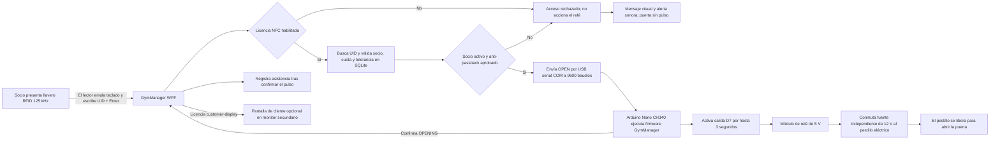

# GymManager — Sistema de Gestión Comercial & Control de Acceso Hardware

> Aplicación de escritorio desarrollada en **C# / WPF** orientada a la gestión integral de gimnasios, automatización de cobros y control de accesos por hardware mediante arquitectura **Offline-First**.

---

## Problemática de Negocio
Muchas PyMEs y centros deportivos sufren interrupciones operativas debido a caídas de conectividad a Internet o complejidad en la supervisión manual de accesos. **GymManager** resuelve esto permitiendo:
* **Autonomía Operativa (Offline-First):** Operación 100% local sin costo de servidor ni dependencia de conexión externa.
* **Control Físico & Auditoría:** El lector RFID introduce el UID del llavero; GymManager valida al socio y, con el hardware instalado, ordena abrir el pestillo eléctrico solo cuando el acceso está autorizado.
* **Adaptabilidad de UI:** Renderizado vectorial adaptable a monitores antiguos o de baja resolución (1024x768).

---

## Stack Tecnológico
* **Lenguaje:** C# (.NET Core / .NET 8)
* **Interfaz Gráfica:** WPF (Windows Presentation Foundation) con XAML y patrón **MVVM**
* **Base de Datos:** SQLite local con Entity Framework Core
* **Integración de Hardware:** `System.IO.Ports` para comunicación serial USB (COM) con Arduino Nano CH340, que acciona un módulo de relé de 5 V.

---

## Integración con Hardware

El lector RFID de 125 kHz funciona como teclado: no se comunica directamente con GymManager mediante NFC. El Nano permanece conectado por USB y recibe las órdenes seriales `IDENTIFY?` y `OPEN`; el firmware limita cada activación del relé a 3 segundos. La cerradura utiliza una fuente propia de 12 V, conmutada por los contactos del relé según el tipo de pestillo. La salida desde adentro debe ser independiente de GymManager y de la PC.

La pantalla de cliente es opcional: se muestra automáticamente en el monitor secundario cuando la licencia incluye `customer-display` y Windows tiene las pantallas en modo Extender. La vista previa manual solo está disponible en compilaciones Debug.

---

## Licenciamiento Criptográfico & Distribución

El sistema implementa un modelo de **licencia permanente y ejecutable offline**, diseñado bajo arquitectura *Zero-Trust* para evitar dependencias con servidores externos de validación y garantizar operatividad continua en el mostrador del gimnasio.

### Esquema de Protección & Firma Criptográfica
* **Enlazado a Hardware (Hardware-Bound):** La licencia se genera a partir del identificador único del equipo (`MachineGuid` de Windows).
* **Firma Asimétrica (RSA / ECDSA):** 
  * Las licencias (`.gymlicense`) se firman digitalmente con una **clave privada** conservada exclusivamente en el perfil del emisor.
  * La aplicación compilada contiene únicamente la **clave pública** del proveedor, utilizada para verificar matemáticamente la integridad del archivo y la pertenencia a la PC cliente.
* **Módulos Granulares de Permisos:** El archivo de licencia define las capacidades habilitadas para el cliente, como `nfc-access` y `customer-display`. Un cliente puede actualizar sus permisos importando una nueva licencia firmada sin necesidad de reinstalar la aplicación ni alterar la base de datos.
* **Persistencia Aislada:** La licencia validada se almacena en `%LOCALAPPDATA%\GymManager\license.gymlicense`, manteniéndose intacta ante actualizaciones del sistema.

---

## Empaquetado & Despliegue (Inno Setup)

Para el despliegue comercial en entornos de cliente final, el software se distribuye mediante un **instalador ejecutable autocontenido** generado con **Inno Setup 6**:

* **Aislamiento de Permisos en Windows:** El ejecutable y las dependencias compiladas en modo *Release* (`win-x64 Self-Contained`) se alojan en `C:\Program Files\GymManager\`.
* **Persistencia de Datos Protegida:** La base de datos activa (`GymManager.db`) y la licencia conviven en `%LOCALAPPDATA%\GymManager\`. De esta forma, el sistema no requiere elevación de privilegios de administrador para operaciones diarias de escritura en SQLite.
* **Ciclo de Actualización Seguro:** Las tareas de instalación y desinstalación preservan la carpeta de datos del usuario, garantizando que el historial de socios, cobros y la licencia de uso no sufran pérdida de información al actualizar la versión del software.

---

## Página Web-Demo
* https://liogarciaa.github.io/gym-manager/

---
